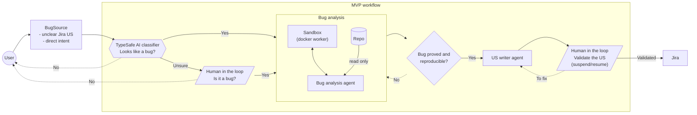

# Architecture

Light clean architecture: three layers, dependencies point inward only.
No ports/interfaces until a second implementation actually exists.

## Workflow (target)



## Dependency rule

```
mastra/ ──► infrastructure/ ──► domain/
   └──────────────────────────► domain/
```

| Layer | May import | Must not import |
|---|---|---|
| `domain/` | `zod`, sibling `domain/` files (`./`) only | anything else (Node built-ins, npm packages, other layers) |
| `infrastructure/` | `domain/`, external SDKs, Mastra **types** | `src/mastra/` |
| `mastra/` | everything above | — |

Enforced by `no-restricted-imports` in [eslint.config.js](eslint.config.js): a violation fails `pnpm check`.

`infrastructure/llm` imports `MastraModelConfig` (a type) on purpose: its job is to produce a
model Mastra accepts, and router strings like `"openai/gpt-5"` only mean something to Mastra.

## Configuration flow

```
.env ──► process.env ──► mastra/index.ts ──► modelFromEnv(env) ──► createXxxAgent(model)
                          (only reader)       (validates at startup)  (receives, never reads env)
```

- Only `src/mastra/index.ts` reads `process.env`. Everything else receives values as arguments.
- Invalid config fails at startup, not at the first LLM call (unknown provider, empty model,
missing API key for `openai` / `anthropic` / `xai`).

## Adding things

**A judgment agent**: `src/mastra/agents/<name>-agent.ts` exports `create<Name>Agent(model)`.
Register it in `src/mastra/index.ts` with the model built there. The prompt holds no business rule.

**An input source** (bug tracker, logs, repo): a plain function in `src/infrastructure/<source>/`
that returns a domain type (e.g. `BugReport`). Its config (URL, token) is read in
`src/mastra/index.ts` and passed as an argument, like the model.

**A workflow step**: one file in `src/mastra/workflows/`, input/output schemas in `src/domain/`.

**A new export**: only when another file uses it.
